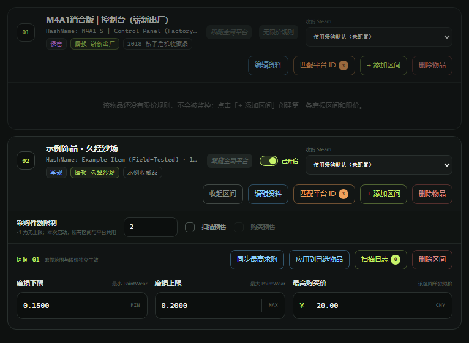
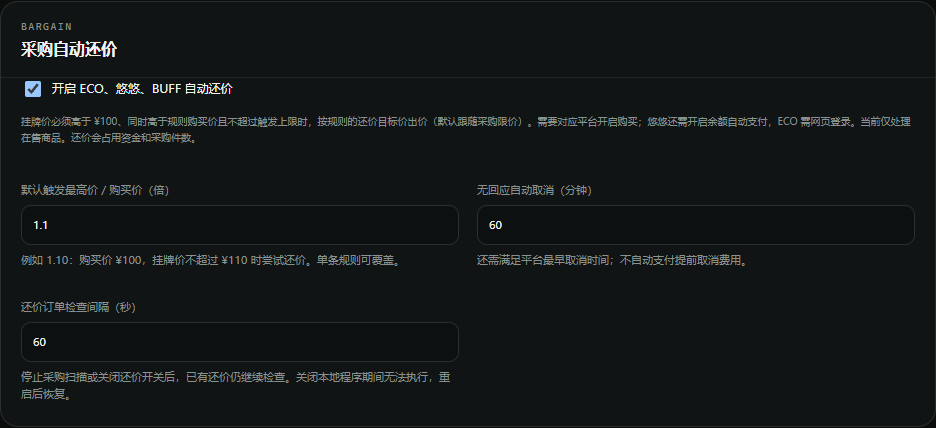
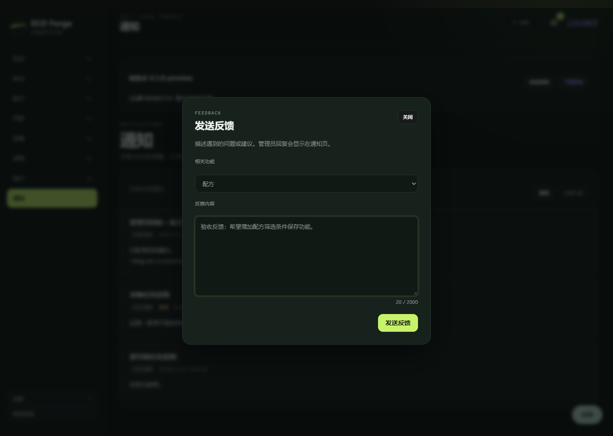
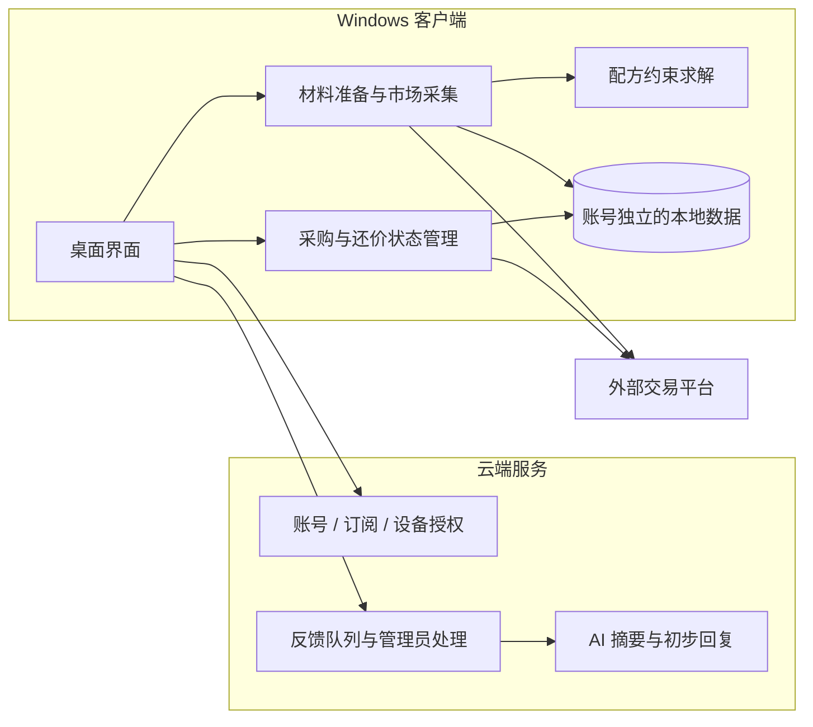

# 合炉工作台 · Furnace Workbench

面向 CS2 饰品合成场景的 Windows 桌面工作台，将市场材料采集、约束配方求解、采购监控与交易记录串成完整工作流。

**本地执行采集与求解，云端管理账号、订阅和反馈。**

[下载安装包](https://github.com/shyshy1107/FurnaceWorkbench-Releases/releases) · [工程设计](docs/engineering.md) · [项目经历](docs/project-experience.md)

> 本仓库用于项目展示与版本分发，应用为闭源软件。这里公开产品说明、设计概述、测试数据截图和安装包，不提供业务源码。使用客户端需要账号及有效授权。

## 从材料到采购

1. **准备材料**：选择材料范围，补全求解需要的物品信息，查看后台任务进度。
2. **采集与求解**：汇总市场挂单，根据数量、磨损和成本等约束生成候选配方。
3. **采购执行**：选择收货 Steam 账号，确认配方购买；也可按规则持续监控价格与磨损区间。
4. **跟踪与反馈**：查看采购、还价记录和通知，直接提交问题或改进建议。

| 能力 | 实现重点 |
| --- | --- |
| 市场材料与配方 | 多平台适配、元数据复用、约束求解、阶段进度与取消 |
| 采购监控 | 平台独立频率、账号选择、采购次数管理、结果核对 |
| 自动还价 | ECO / 悠悠 / BUFF；目标价、触发上限、状态跟踪与超时取消；默认关闭 |
| 桌面交付 | Windows 安装程序、原生窗口、离线帮助、覆盖升级保留用户数据 |
| 账号与订阅 | 云端授权、设备管理、账号资料隔离与管理员权限控制 |
| AI 辅助反馈 | 整理建议与复现信息，只追问关键缺口；管理员可继续跟进 |
| 更新发布 | GitHub Releases、QQ 群文件、简短更新日志、群公告与全体提醒 |

## 界面预览

以下为测试环境中的实际界面，使用示例数据，不展示真实账号或订单。截图中的数值用于演示，不代表推荐采购参数。

### 按价格和磨损区间管理采购规则

### 自动还价设置

可设置触发范围与检查间隔。截图展示开启状态，实际安装后的总开关默认关闭。

### 反馈入口

用户描述问题或建议后，回复进入工作台通知页。AI 初步回复明确标注来源，人工回复保留。

## 架构概览

计算和持续监控在用户设备运行，云端集中处理授权与反馈，避免把每个用户的采集和求解负载累积到服务器。更多取舍见[工程设计](docs/engineering.md)。

## 技术栈

| 层次 | 技术 |
| --- | --- |
| 桌面与界面 | Python、pywebview / WebView2、JavaScript、HTML / CSS |
| 采集与求解 | Python、Playwright、OR-Tools、SQLite |
| 云端服务 | Node.js、SQLite、HTTPS、阿里云 ECS |
| AI 反馈 | MiMo API、异步任务队列、结构化结果校验 |
| 构建与发布 | Cython、PyInstaller、Inno Setup、GitHub Releases、QQ Bot |

## 交付与验证

项目已提供 Windows x64 预览安装包，更新内容以 [Releases](https://github.com/shyshy1107/FurnaceWorkbench-Releases/releases) 为准。

- 核心逻辑测试覆盖规则、状态转换、授权生命周期和反馈处理。
- 生成后的分发界面通过浏览器自动化检查，交易相关测试使用隔离数据。
- 发布前检查包内容、文件摘要、冻结程序启动及安装、覆盖升级和卸载行为。
- 安装包更新保留已绑定账号、登录凭据和个人配置；退出工作台后运行新安装包。

求解结果基于采集快照，实际可用库存和价格会变化；可行结果与已证明的快照内最优结果分别标记。

## 获取与反馈

从 [Releases](https://github.com/shyshy1107/FurnaceWorkbench-Releases/releases) 下载 Windows x64 安装包。已安装用户可在工作台内检查更新，使用右下角反馈入口提交问题或建议。

下载 `FurnaceWorkbench-Setup-版本-win-x64.exe` 后双击安装，每个版本附 SHA256 校验文件。GitHub 下载不便时，也可从发布 QQ 群的群文件获取相同安装包。

仓库公开不代表应用源码开源，也不构成对软件的开源许可。
